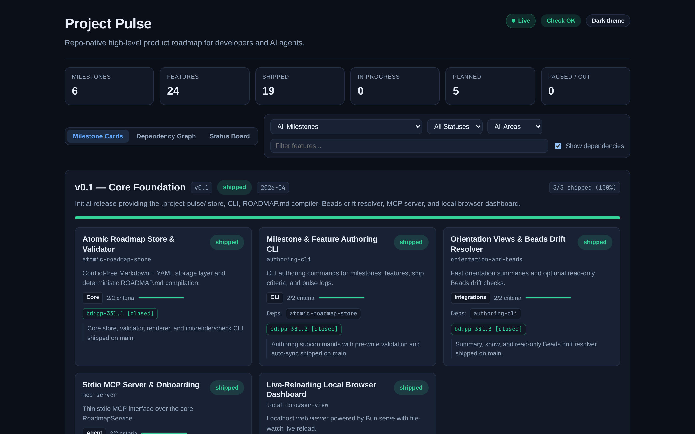
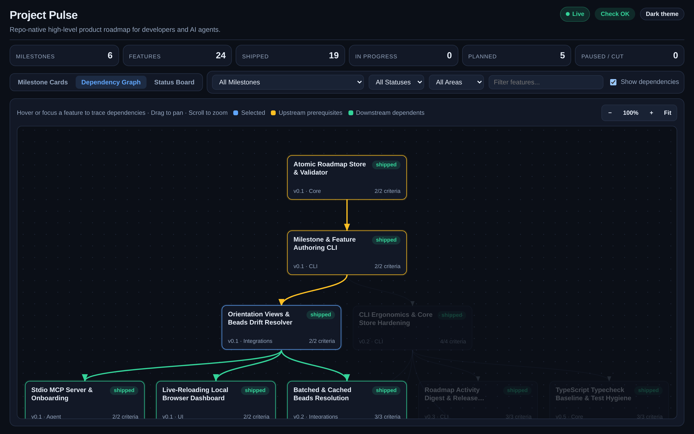
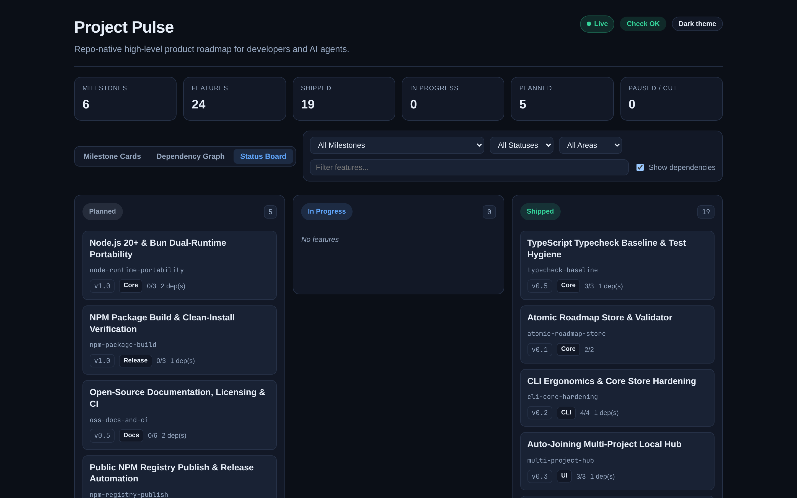

# Project Pulse (`project-pulse` / `pp`)

[](https://github.com/mcrescenzo/project-pulse/actions/workflows/ci.yml)
[](LICENSE)

**A high-level product roadmap that lives in your repository, built for developers and AI coding agents.**

Planning tends to end up either buried in granular task trackers or in a hand-maintained `ROADMAP.md` that quickly goes stale. Project Pulse keeps milestones and features as small Markdown files under `.project-pulse/`, and regenerates a deterministic `ROADMAP.md` on every change. You can work with the same roadmap through:

- a CLI (`pp`)
- an MCP server for agents (`pp mcp`)
- a live browser dashboard (`pp view`)
- a mouse-friendly terminal dashboard (`pp view --tui`)



<table>
  <tr>
    <td></td>
    <td></td>
  </tr>
</table>

## Features

- **Repo-native store:** one Markdown + YAML file per milestone and per feature. Changes merge cleanly, diff nicely, and need no server. Values are written with round-trip-verified YAML, so titles that look like numbers, booleans, or dates — or end in a colon — survive add, reload, and `pp check` byte-exact on every supported Bun (1.3+).
- **Generated `ROADMAP.md`:** deterministic, always in sync, and `pp check` validates it.
- **Altitude guardrails:** only milestones and features, with 2–6 outcome-level ship criteria each. Granular tasks belong in your issue tracker.
- **Agent-ready:** token-lean `pp summary`, `--json` on every command, a stdio MCP server, and `pp setup` to wire up `AGENTS.md` and MCP config.
- **Dashboards:** a multi-project local hub with cards, dependency graph, and status board views, plus live reload and quick actions. There's also a TUI for SSH and tmux.
- **Reporting:** `pp digest` for recent activity, `pp changelog` for release notes, and `pp export --html` for a self-contained offline snapshot.
- **Optional [Beads](https://github.com/steveyegge/beads) integration:** link features to `bd:<id>` issues to see their live status and detect drift. Read-only, and entirely optional.

## Install

Project Pulse runs on [Bun](https://bun.sh/) **1.3+**. npm distribution is planned for v1.0.

```bash
git clone https://github.com/mcrescenzo/project-pulse.git
cd project-pulse
bun install        # dev/test dependencies only; the CLI has no runtime dependencies
bun link           # puts `pp` and `project-pulse` on your PATH
pp --version
```

You can also skip linking and run it in place with `bun run /path/to/project-pulse/src/cli.ts <command>`.

## Quick start

From the root of any repository:

```bash
pp init --name "My Project" --summary "High-level roadmap."
pp milestone add v0.1 --title "v0.1 — Core Foundation" --status active --target "2026-Q4"
pp feature add offline-sync --title "Offline-First Sync" --milestone v0.1 --area Core \
  --criterion "Queue local changes offline" \
  --criterion "Reconcile cleanly on reconnect"

pp summary                                   # orient
pp feature check offline-sync 1              # tick a ship criterion
pp feature note offline-sync "Queue landed"  # log progress
pp view                                      # open the live dashboard
```

`pp init` won't overwrite an existing hand-written `ROADMAP.md`. Move it aside, or pass `--force`.

## Commands

| Command | Description |
| :--- | :--- |
| `pp` | Runs `summary` if the repo is initialized, otherwise shows help. |
| `pp init [--name <name>] [--summary <text>] [--agents-snippet] [--force]` | Creates `.project-pulse/` and generates `ROADMAP.md`. |
| `pp setup [--mcp <path>] [--with-skill] [--dry-run]` | Idempotently wires up `AGENTS.md` instructions, MCP server config, and an optional agent skill file. |
| `pp summary [--milestone <id>] [--status <s>] [--json]` | Token-lean overview of milestones, features, criteria progress, and latest notes. |
| `pp show <feature-id> [--beads \| --no-beads] [--json]` | One feature in full: description, criteria, dependencies, update log, linked issues. |
| `pp milestone add\|update\|remove <id> ...` | Manage release milestones. |
| `pp feature add\|update\|remove <id> ...` | Manage features (`--add-criterion`, `--remove-criterion`, `--depends-on`, `--add-ref`, …). |
| `pp feature check <feature-id> <criterion> [--done\|--undone]` | Toggles or sets a ship criterion. |
| `pp feature note <feature-id> "<message>"` | Appends a timestamped progress note. |
| `pp digest [--since <date\|7d\|git-ref>] [--milestone <id>]` | Recent progress: shipped features, status changes, criteria, notes. |
| `pp changelog [<milestone-id>] [--all]` | Markdown release notes for one milestone or the whole roadmap. |
| `pp export --html [--out <path\|->] [--beads]` | Self-contained, zero-network HTML snapshot. |
| `pp check [--beads] [--json]` | Validates schema, dependency DAG, `ROADMAP.md` sync, and optionally Beads drift. |
| `pp render` | Regenerates `ROADMAP.md`. |
| `pp view [--port <n>] [--standalone] [--no-open]` | Starts or joins the local multi-project dashboard hub. |
| `pp view --tui [--no-beads]` | Interactive terminal dashboard. |
| `pp mcp` | Stdio MCP server. |

Every command accepts `--root <dir>` (default: the nearest parent directory containing `.project-pulse/`), and most accept `--json`.

## Browser dashboard (`pp view`)

`pp view` starts a local hub on `http://127.0.0.1:4310`, or joins one that's already running, and opens your project at `/p/<repo>`. Run it in several repositories and they all appear on the hub's overview page. `--standalone` runs a single-project server instead.

The dashboard is protected by an **access token**:
- `pp view` prints and opens a URL ending in `?t=<token>`.
- Your browser exchanges that token for a session cookie, so bookmarks keep working afterwards.
- With `--no-open`, copy the printed URL into your browser.
- The token is stored at `~/.config/project-pulse/access-token` (mode 0600). Set `PROJECT_PULSE_HOME` to use a different directory, and delete the file to rotate the token.

See [SECURITY.md](SECURITY.md) for the full model.

## Terminal dashboard (`pp view --tui`)

```bash
pp view --tui [--no-beads]
```

- **Views and filters:** click the tabs, or press `1` (Milestone Cards), `2` (Dependency Graph), or `3` (Status Board).
  - Click the filter pills (`M:`, `S:`, `A:`), press `/` for live search, or click `Reset`.
- **Waterfall graph:** a top-to-bottom dependency DAG.
  - Three zoom densities: use the mouse wheel, `+`/`-`, `0`, `F`, or the toolbar buttons.
  - Click and drag to pan.
  - Hovering traces upstream dependencies in amber and downstream ones in green; clicking opens the drawer. Press `h` to switch to click-to-trace.
- **Detail drawer:** shows as a split pane on terminals at least 120 columns wide, and as a modal on narrower ones.
  - Change the status, toggle criteria (`Space`), and add notes (`n`, then `Enter`).
  - Changes are saved immediately and reload live.
- **SSH ergonomics:**
  - `m` toggles mouse capture, so you can select text natively.
  - `y` copies the feature id via OSC 52.
  - `?` shows the shortcuts.
  - `q` quits and restores your terminal.

## AI agents and MCP

The quickest way to wire up an agent:

```bash
pp setup --mcp .mcp.json          # adds an AGENTS.md block and an MCP server entry (merged, idempotent)
```

Or configure the MCP server yourself:

```json
{
  "mcpServers": {
    "project-pulse": { "command": "pp", "args": ["mcp"] }
  }
}
```

If `pp` isn't on your PATH, use `"command": "bun", "args": ["run", "/path/to/project-pulse/src/cli.ts", "mcp"]`.

MCP tools: `roadmap_summary`, `roadmap_show_feature`, `roadmap_upsert_milestone`, `roadmap_upsert_feature`, `roadmap_log_pulse`, `roadmap_check`.

## Beads integration (optional)

If you track tasks with [Beads](https://github.com/steveyegge/beads), add refs such as `--add-ref bd:proj-42` to a feature. The `pp show`, `pp check --beads`, and dashboard views then show each issue's live status and flag drift, for example a shipped feature with open issues. Project Pulse only reads from `bd` and never writes to it. Without Beads installed, everything else works the same. To turn the integration off, set `integrations.beads.enabled: false` in `.project-pulse/config.yaml`.

## Documentation

- [Architecture and store schema](docs/architecture.md)
- [Security policy](SECURITY.md) and the [v0.5 security audit](docs/security-audit.md)
- [Contributing](CONTRIBUTING.md)
- [Changelog](CHANGELOG.md), plus this project's own roadmap: [ROADMAP.md](ROADMAP.md)

## Development

```bash
bun install
bun run typecheck
bun test
```

See [CONTRIBUTING.md](CONTRIBUTING.md) for the browser UI test setup and project conventions.

## License

[MIT](LICENSE) © 2026 Michael Crescenzo
